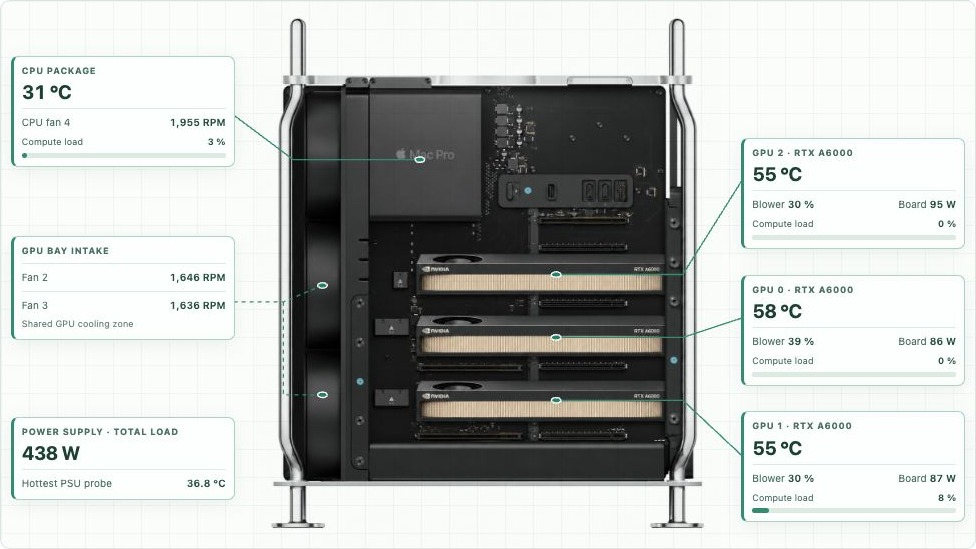
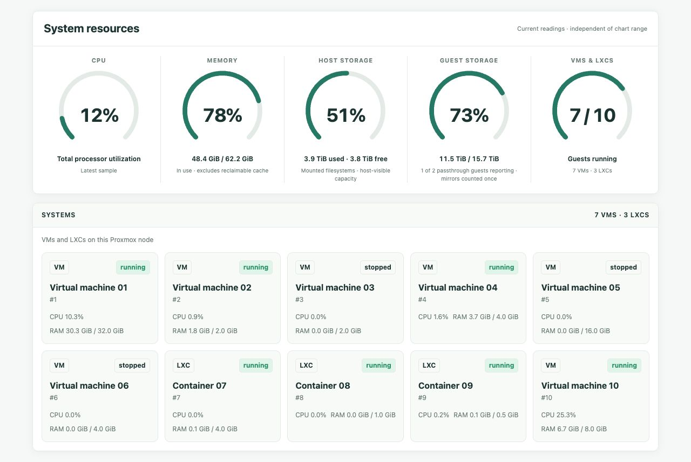

# Hardware Dashboard

Multiplatform hardware monitoring for Linux workstations and Proxmox hosts.
Live dashboards bring together temperatures, CPU/GPU load, memory pressure,
fan speeds, power, storage usage and system events.

## Choose your setup

| Platform | Support | Guide |
|---|---|---|
| Mac Pro 7,1 on Linux | SMC telemetry via neofand, PSU power, NVIDIA/AMD sensors and two-sided chassis diagrams | [Optional fan daemon](https://github.com/akhilv1/neofand) · [Dashboard](dashboard/README.md) |
| Linux / ThinkStation P620 | Read-only CPU, RAM/PSI, hwmon and NVIDIA/AMD telemetry, storage and events | [Linux adapter](dashboard/linux/README.md) |
| Proxmox LXC | Native web/API services with a separate physical-host collector; node, VM/container and task status | [LXC installation](dashboard/lxc/README.md) |

Missing hardware readings remain unavailable. The Linux adapter and Proxmox
collectors are read-only; fan control belongs to the Mac Pro daemon.

## See it running

**Mac Pro with three RTX A6000s**



[Memory / PSU view](docs/screenshots/mac-pro-memory-sensors.jpg) ·
[ThinkStation P620 / RTX 3090](docs/screenshots/p620-sensors.jpg)

Live captures with identifying information cropped out. Chassis artwork and
sensor positions are illustrative; see [capture notes](docs/screenshots/README.md).

**Proxmox host, VM/LXC inventory, and resource overview**



Guest names and IDs are anonymized, and host/network identity is omitted. Resource readings and guest states are unchanged.

Bare-metal Docker hosts also have a **Portainer** page with container state, health checks, Compose projects, CPU/RAM usage and a link to the management UI. The page reads a host-generated snapshot; the web container has no Docker socket or Portainer credentials. [Setup and access model](dashboard/PORTAINER.md).

## What’s included

- **Sensors and history:** load bars, temperatures, fan speeds, board/system power
  where available, memory usage/pressure, auto/live controls and sample timestamps.
- **Storage:** raw drives, boot/system badges, used/available space, category
  indexing with a metadata cache, and ZFS mirror/pool accounting.
- **GPU builder:** combine PCIe cards and Apple MPX modules in chassis views,
  with dimensions, slot occupancy and collision checks. [GPU library](dashboard/assets/gpu-library/README.md).
- **Events:** host warnings and restart history; telemetry gaps alone do not
  establish a power outage.

## Get started

```sh
git clone https://github.com/akhilv1/hardware-dashboard.git
cd hardware-dashboard
```

Choose the Linux/Docker, Mac Pro, or Proxmox guide above. These are deployment
templates: configure the service account, paths, telemetry source and private
ingress for your host before starting them. The source lives in `dashboard/`;
there is no Rust build or fan-control daemon required for Linux and Proxmox.

Mac Pro SMC telemetry comes from the separately installed
[neofand daemon](https://github.com/akhilv1/neofand), built with its `web` feature.
It owns fan control and raw SMC reads. The dashboard connects through the
GET-only proxy; it does not probe raw SMC keys or write fan controls.

Existing `neofand-*` service names, environment variables, data directories and
the `/hardware/` URL remain supported. Splitting the repositories does not
require reinstalling or restarting a working deployment.

## Development

The application uses static HTML/CSS/JavaScript and Python host collectors/APIs.
Run `bash tools/check.sh` with Python 3.10+ and Node.js 18+ to check the dashboard,
Linux and Proxmox tests, GPU placement logic, resource dials and generated pages.
No hardware access, Docker socket or Rust checkout is needed for these checks.

See [architecture and compatibility](docs/ARCHITECTURE.md) and
[repository migration](docs/REPOSITORY-SPLIT.md).

## Documentation

[Optional Mac Pro fan daemon](https://github.com/akhilv1/neofand) ·
[Mac Pro hardware findings](https://github.com/akhilv1/neofand/blob/master/MACPRO71-FINDINGS.md) ·
[Dashboard deployment](dashboard/README.md) ·
[GPU library and builder](dashboard/assets/gpu-library/README.md)

GPL-3.0-or-later. Extracted from [neofand](https://github.com/akhilv1/neofand),
a fork of [T2FanRD](https://github.com/GnomedDev/T2FanRD). Original authorship and
applicable license notices are retained; see [provenance](docs/REPOSITORY-SPLIT.md).

## Security

Read [SECURITY.md](SECURITY.md) before deploying. Dashboard containers require only read-only generated telemetry, not host devices or administrative sockets. New LXC templates are private by default. See the [November 2026 review](docs/security-review-2026-11.md) for fixes, verification and remaining boundaries.
